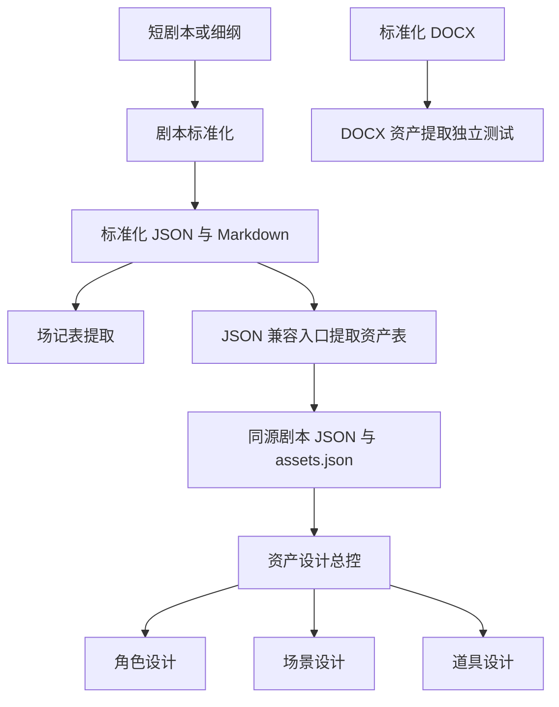

# 开宝箱 · 剧本与资产插件公开测试镜像

本仓库用于本轮外部测试，当前快照为 **public-test-2026-10-27-r4**。统一安装目录包含剧本标准化、场记表提取、剧本资产表提取和资产设计总控四个业务插件。资产总控包内已带角色、场景和道具子插件；直接使用 `$asset-scene` 会进入本快照内更新后的场景能力。

本轮以 [script-plugins](https://github.com/kaibaoxiang-studio/script-plugins) 为剧本业务权威来源，以 [ZiChan](https://github.com/kaibaoxiang-studio/ZiChan) 为角色、场景、道具业务权威来源；资产母仓库提供总控外壳。各来源固定到明确提交，领域版本沿用对应提交的 manifest，并保留来源哈希和现有许可声明。完整来源及逐文件变化见 [mirror-sources.json](mirror-sources.json)，核验结果见 [公开镜像验证](public-validation.json)。

## 安装

需要支持插件功能的 Codex、可用账号，以及 Python 3.12+。从公开镜像安装无需访问原私有仓库：

```sh
codex plugin marketplace add https://github.com/kaibaoxiang-studio/script-assets-public-test.git --ref public-test-2026-10-27-r4
codex plugin add screenplay-standardizer@script-assets-public-test
codex plugin add scene-log-extractor@script-assets-public-test
codex plugin add screenplay-asset-extractor@script-assets-public-test
codex plugin add asset-design@script-assets-public-test
```

也可从 [本轮测试 Release](https://github.com/kaibaoxiang-studio/script-assets-public-test/releases/tag/public-test-2026-10-27-r4) 下载完整 ZIP，解压后运行 `python3.12 scripts/install.py`。安装后新开聊天，在输入框选择相应插件或 Skill。

已安装旧快照时，先更新公开测试市场的注册与资产总控缓存，再执行上面的四条 `plugin add`：

```sh
codex plugin remove asset-design@script-assets-public-test
codex plugin marketplace remove script-assets-public-test
codex plugin marketplace add https://github.com/kaibaoxiang-studio/script-assets-public-test.git --ref public-test-2026-10-27-r4
```

这一步只针对本公开测试市场。母插件版本仍为 0.1.0，重新安装用于确保包内领域快照也已更新；新开聊天后再测试。未安装过旧快照时直接按首次安装步骤操作。

每个组件都保留自己的 `requirements.lock` 和 `scripts/bootstrap.py`。缺少依赖时，按该组件的启动提示执行 `python3.12 <插件目录>/scripts/bootstrap.py --install`。DOCX 资产提取入口另声明 `python-docx==1.1.2` 和 `openpyxl==3.1.5`，其用法见 [DOCX 提取 Skill](script-plugins/level-2/asset-extraction/screenplay-asset-extractor/skills/script-asset-extractor/SKILL.md)。实际模型调用使用测试者自己的账号配置。

## 本轮版本与入口

| 插件 | 版本 | 主要入口 | 文档 |
| --- | --- | --- | --- |
| 剧本标准化 | 0.1.2 | `$standardize-screenplay`、`$review-screenplay` | [标准化组件](script-plugins/level-1/screenplay-standardization/README.md) |
| 场记表提取 | 0.1.0 | `$extract-scene-log` | [场记组件](script-plugins/level-2/scene-log-extraction/README.md) |
| 剧本资产表提取 | 插件 0.1.1；DOCX Skill 0.1.2 | `$script-asset-extractor`；JSON 兼容入口 `$extract-asset-table` | [资产表组件](script-plugins/level-2/asset-extraction/README.md) |
| 资产设计总控 | 0.1.0 | `$asset-design`、`$asset-character`、`$asset-scene`、`$asset-prop` | [资产设计组件](asset-design-plugin/README.md) |

资产总控本轮封装 ZiChan 提交 `e089d1287c1499f08c42e75aca093131e9d3fbc0`：角色 **0.2.13**、场景 **0.9.5**、道具 **0.2.5**。这里的“当前版本”按权威仓库提交内的 manifest 核对，不能用版本号大小替代来源检查；旧测试标签保留其历史快照。

剧本来源固定为 `script-plugins` 提交 `b1f232c743a927a4f7c94f02c1dede2fab4e49a0`，含 DOCX 主入口；资产母插件外壳沿用 `asset-design-plugin` 提交 `2c4a66669ced1d2ee2cc8cd1c1636c09e67599bf`，其包内三类业务快照由上述 ZiChan 提交替换。`r4` 是公开测试快照标识，不是母插件新正式版本；原私有仓库和原标签保持历史记录。

## 建议测试顺序



联测资产总控时，使用同一份标准化剧本 JSON 和 JSON 兼容入口生成的 `assets.json`，使资产表的来源 SHA256 与剧本一致。DOCX 入口适合独立检查人物状态、道具身份和 Excel 交付；它的文档来源合同与母插件的 JSON 合同分别核对，不把文件改名当作格式转换。

遇到旧版“道具为 0”或人物层级全空的输出时，请用原始标准剧本重新提取；更新插件不会自动补全旧表。选中本次安装的「剧本资产表提取」后，可先调用 `$screenplay-asset-extractor` 按输入路由到包内入口，避免误用个人目录中的旧同名 Skill。

详细用例、合成材料和反馈方式见 [测试指南](PUBLIC_TEST_GUIDE.md)。发现问题请 [提交 Issue](https://github.com/kaibaoxiang-studio/script-assets-public-test/issues/new/choose)，注明本轮日期标签、插件／Skill 版本、操作步骤、预期与实际结果。

## 目录与分发

```text
script-plugins/               剧本仓库的固定源码快照及三类业务插件
asset-design-plugin/         资产总控与锁版角色／场景／道具子插件
.agents/plugins/marketplace.json  本轮统一安装目录
scripts/                     镜像校验、打包与本地目录安装
mirror-sources.json          来源提交、源文件哈希与公开导出变换
public-validation.json       本轮实际验证结果
```

原工程维护源码、测试和归属文件随快照保留；运行三个剧本业务插件无需安装 Harness Creator。各目录中的上游历史发布记录用于追溯，本轮下载和安装以本页及公开 Release 为准。来源与许可见 [分发说明](NOTICE.md)。

## r4 角色插件更新

本轮同步 ZiChan 角色资产插件 **0.2.13**：逐状态可见需求可重新激活妆发饰，细化重点服装部件、穿戴部位、连接和跨视角连续性。见[角色 README](asset-design-plugin/bundled-plugins/character-assets/README.md)。剧本套件 **1.0.2**、资产提取器 **0.1.1**（DOCX Skill **0.1.2**）、场景 **0.9.5** 和道具 **0.2.5** 保留 r3 业务内容。母插件仍为 **0.1.0**；更新市场并重装母插件后新开聊天，确认包内角色版本为 0.2.13。本轮检查与历史模型/图片验证分开记录，见 public-validation.json。

## r3 修补范围

剧本套件 1.0.2 / 资产提取器 0.1.1（DOCX Skill 0.1.2）在 JSON 和 DOCX 路线上加入逐场语义审核与来源/资产快照绑定，阻止底稿直接正式交付；零道具仍可在有依据的完整审核后通过。角色同步为 ZiChan 0.2.6.4-local，场景 0.9.5 和道具 0.2.5 的业务字节及原有脱敏变换保持本轮已核验快照。新测试结果以 public-validation.json 和实际检查记录为准，历史结果不自动转为本轮通过。
