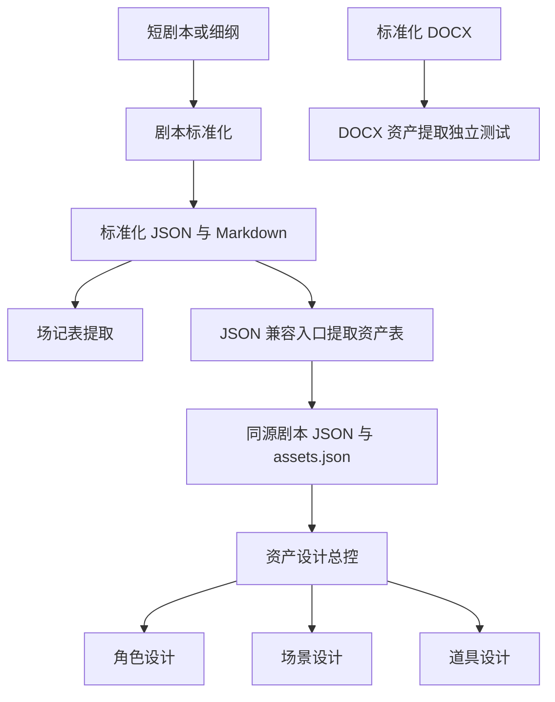

# 开宝箱 · 剧本与资产插件公开测试镜像

本仓库用于本轮外部测试，快照日期 **2026-10-27**。统一安装目录包含剧本标准化、场记表提取、剧本资产表提取和资产设计总控四个业务插件。资产总控包内已带角色、场景和道具子插件。

来源固定到各自提交；插件功能版本保持原号。公开导出只调整安装说明、匿名化本机路径和历史项目定位信息，保留设计方法、来源哈希和现有许可声明。完整来源及逐文件变化见 [mirror-sources.json](mirror-sources.json)，核验结果见 [公开镜像验证](public-validation.json)。

## 安装

需要支持插件功能的 Codex、可用账号，以及 Python 3.12+。从公开镜像安装无需访问原私有仓库：

```sh
codex plugin marketplace add https://github.com/kaibaoxiang-studio/script-assets-public-test.git --ref public-test-2026-10-27
codex plugin add screenplay-standardizer@script-assets-public-test
codex plugin add scene-log-extractor@script-assets-public-test
codex plugin add screenplay-asset-extractor@script-assets-public-test
codex plugin add asset-design@script-assets-public-test
```

也可从 [本轮测试 Release](https://github.com/kaibaoxiang-studio/script-assets-public-test/releases/tag/public-test-2026-10-27) 下载完整 ZIP，解压后运行 `python3.12 scripts/install.py`。安装后新开聊天，在输入框选择相应插件或 Skill。

每个组件都保留自己的 `requirements.lock` 和 `scripts/bootstrap.py`。缺少依赖时，按该组件的启动提示执行 `python3.12 <插件目录>/scripts/bootstrap.py --install`。DOCX 资产提取入口另声明 `python-docx==1.1.2` 和 `openpyxl==3.1.5`，其用法见 [DOCX 提取 Skill](script-plugins/level-2/asset-extraction/screenplay-asset-extractor/skills/script-asset-extractor/SKILL.md)。实际模型调用使用测试者自己的账号配置。

## 本轮版本与入口

| 插件 | 版本 | 主要入口 | 文档 |
| --- | --- | --- | --- |
| 剧本标准化 | 0.1.2 | `$standardize-screenplay`、`$review-screenplay` | [标准化组件](script-plugins/level-1/screenplay-standardization/README.md) |
| 场记表提取 | 0.1.0 | `$extract-scene-log` | [场记组件](script-plugins/level-2/scene-log-extraction/README.md) |
| 剧本资产表提取 | 插件 0.1.0；DOCX Skill 0.1.1 | `$script-asset-extractor`；JSON 兼容入口 `$extract-asset-table` | [资产表组件](script-plugins/level-2/asset-extraction/README.md) |
| 资产设计总控 | 0.1.0 | `$asset-design`、`$asset-character`、`$asset-scene`、`$asset-prop` | [资产设计组件](asset-design-plugin/README.md) |

资产总控锁版子插件为角色 **0.2.6.2**、场景 **1.0.0**、道具 **0.2.0**。本轮公开镜像保持这组已发布依赖，未随独立子仓库的新提交自动切换。

剧本来源为 `script-plugins` 提交 `c1a101d87cd2d35f8c92ac382ed34e3860fb046e`，含其最新 DOCX 入口；资产总控来源为 `asset-design-plugin` 提交 `2c4a66669ced1d2ee2cc8cd1c1636c09e67599bf`。这里的日期标签表示测试快照，不给业务插件增加新版本号。

## 建议测试顺序



联测资产总控时，使用同一份标准化剧本 JSON 和 JSON 兼容入口生成的 `assets.json`，使资产表的来源 SHA256 与剧本一致。DOCX 入口适合独立检查人物状态、道具身份和 Excel 交付；它的文档来源合同与母插件的 JSON 合同分别核对，不把文件改名当作格式转换。

详细用例、合成材料和反馈方式见 [测试指南](PUBLIC_TEST_GUIDE.md)。发现问题请 [提交 Issue](https://github.com/kaibaoxiang-studio/script-assets-public-test/issues/new/choose)，注明本轮日期标签、插件／Skill 版本、操作步骤、预期与实际结果。

## 目录与分发

```text
script-plugins/               剧本仓库的固定源码快照及三类业务插件
asset-design-plugin/         资产总控与锁版角色／场景／道具子插件
.agents/plugins/marketplace.json  本轮统一安装目录
scripts/                     镜像校验、打包与本地目录安装
mirror-sources.json          来源提交、源文件哈希与公开导出变换
public-validation.json       本轮实际验证结果
```

原工程维护源码、测试和归属文件随快照保留；运行三个剧本业务插件无需安装 Harness Creator。各目录中的上游历史发布记录用于追溯，本轮下载和安装以本页及公开 Release 为准。来源与许可见 [分发说明](NOTICE.md)。
