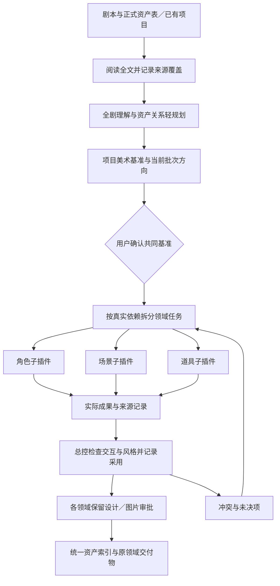
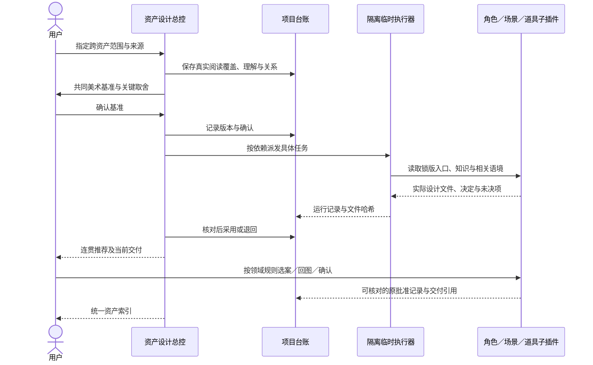
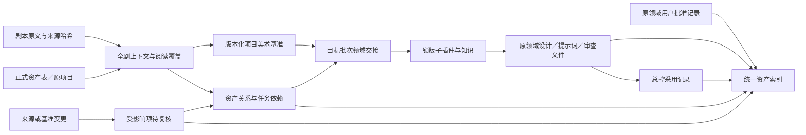

# 资产设计插件 v0.1.0

从完整剧本建立共同美术基准，统筹角色、场景、道具的具体设计，并保留每个决定的来源、版本、审批和交付记录。

> 公开测试镜像：插件及子插件版本保持原发布版本，运行代码与设计规范沿用上游。来源定位文档经过匿名化，锁文件区分上游字节与公开导出字节；变换记录见 [公开导出清单](public-export-manifest.json)。`validation/` 中真实调用和原发布验收属于 2026-10-23 的上游历史验证，公开镜像只复核本地结构与回归，不重新声称执行了真实 API 调用。

正式发布仓库：[kaibaoxiang-studio/asset-design-plugin](https://github.com/kaibaoxiang-studio/asset-design-plugin)。这是独立母插件，包内封装三个子插件；ZiChan 继续维护其独立版本。

## 四个入口

| 入口 | 用途 |
| --- | --- |
| `$asset-design` | 明确请求跨资产协同时，阅读全文、形成项目美术基准、安排依赖、调用并整合三类资产 |
| `$asset-character` | 人物理解、身份与身体设计、服饰、提示词和回图审查 |
| `$asset-scene` | 静态场景设计、光影色卡、反打与其他角度、局部修改 |
| `$asset-prop` | 道具具体设计、批量 Prompt 表、选案、回图与状态扩展 |

单领域入口可直接使用，不必先启动总控。总控先做全剧轻规划，只深化用户当前指定批次；共同风格落实到世界规则和设计语言，保留各领域与角色差异。人物专属分析由角色子插件完成，场景按场景子插件准则推进，道具保留其选案和主视觉规则。

## 安装与开始

需要 Python 3.12+、Codex CLI 和当前用户的可用模型配置。包内 Python 依赖通过 `requirements.lock` 固定；缺少依赖时按启动器提示安装到用户缓存。

从本仓库 Release 获取完整安装包并解压，在解压目录运行：

```sh
python3 scripts/install.py
python3 harness.py doctor
```

安装脚本使用 Codex 的插件 CLI 注册本地 marketplace 并安装 `asset-design@asset-design-local`。若 CLI 不在 PATH，可传 `--codex-bin /absolute/path/to/codex`；先查看计划可加 `--dry-run`。安装后新开聊天刷新入口列表。母包包含锁定的子插件目录，不需要另装三个领域插件；原有独立安装可并存。

调用示例：

```text
请使用 $asset-design，读取这份标准化剧本和资产表，先建立全剧理解与美术基准，
本轮统筹 CHR-001、SCN-002 和 PRP-003，检查它们的使用、尺度与风格关系。

请使用 $asset-scene，只深化 SCN-002 当前已确认布局的光影，不重做其他资产。
```

正式剧本标准化、场记和资产提取由独立剧本插件提供。本插件接受这些产物；只有原始剧本时也可分析和提出临时工作清单，临时标识不冒充正式资产 ID。

## 工作流



总控采用只表示该成果可用于整合。设计选案、阶段批准和具体图片定稿仍在对应领域记录。提示词已交、等待回图、领域批准与受变更影响待复核会分别展示。

## 时序图



内部派发使用临时执行会话，不创建用户侧的新聊天。独立任务可以并行；任务完成后由总控查看真实文件并记录采用，再推进其依赖项。某项失败或缺资料只暂停相关任务，不能用模拟结果代替。

## 数据流图



源资料、推导、创作选择和新增设定分别记录。来源更新保留历史，标记受影响项目；总控不会用一条批准覆盖所有领域。已有角色项目通过显式导入核对来源版本、稳定 ID 与文件哈希，保留能验证的批准。

## 项目命令与数据

```sh
python3 harness.py init --project /absolute/project --script /absolute/screenplay.json --assets /absolute/assets.json
python3 harness.py status --project /absolute/project
python3 harness.py index --project /absolute/project
```

完整命令和阶段操作见 [工作流](references/workflow.md)，数据合同见 [接口](references/interfaces.md)。阅读覆盖由模型实际阅读后提交；结构校验只能证明记录完整，不能代替人物、空间和道具设计质量的检查。母插件以文字设计和提示词为主要交付，实际图像按各子插件规则回流与审批。

## 封装与验证

| 子插件 | 锁版版本 | 主要入口 |
| --- | --- | --- |
| 角色资产插件 | v0.2.6.2 | `character-assets` |
| 场景资产插件 | v1.0.0 | `sence-prompts` |
| 道具资产插件 | v0.2.0 | `prop-concept-design` |

来源提交与逐文件哈希保存在 [bundle-lock.json](bundle-lock.json)，原目录、知识引用与来源声明随包保留。更新需显式锁版并检查兼容，不自动追随 ZiChan 新版。封装说明见 [来源追溯](references/package-provenance.md)及 [第三方来源](THIRD_PARTY_NOTICES.md)。

```sh
python3 harness.py validate
python3 -m unittest discover -s tests -v
```

发布验证覆盖四入口、封装哈希、来源与 ID、审批保留、依赖调度、局部失效和临时执行隔离，并以小型剧本对三领域做真实文字调用。完整项目与图片审美由使用者测试；具体已执行结果见 [v0.1.0 验证记录](validation/v0.1.0.md)，三领域调用的可复核收据见 [真实调用报告](validation/real-call-report.json)。
