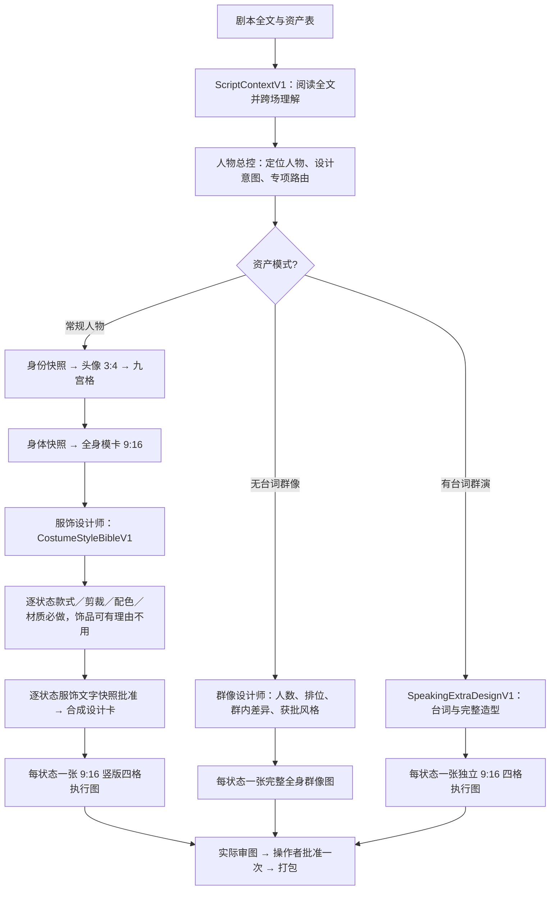
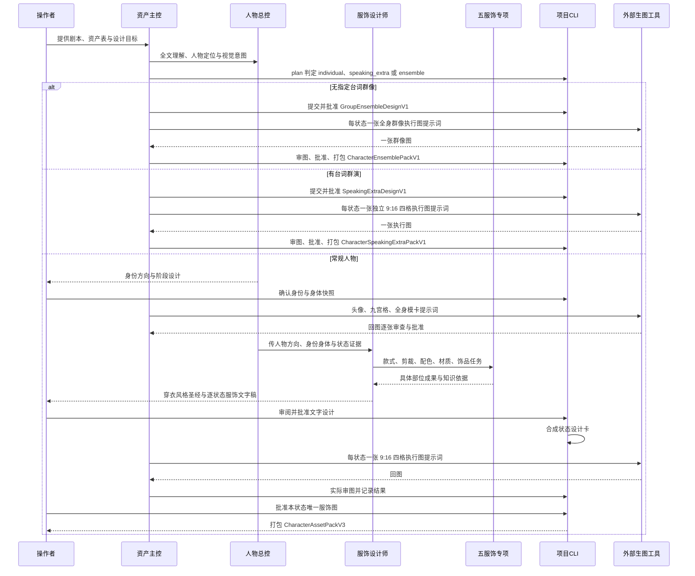
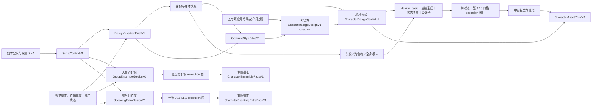

# 角色资产插件 v0.2.13

本版按已安装的 `0.2.13` 同步到 ZiChan 与公开测试镜像；图片效果仍按项目审图与操作者批准。

本版在每个剧情状态做可见需求判断，允许基础身份中“不需要”的妆发饰在有场次依据时重新激活；执行提示词逐项校验已选妆发、首饰和服装部件的可见细节。旧 V1 状态记录继续可读。

**服饰细节物件化**：重点服装先确定远景衣片关系与近景结构焦点，再将腰扣、外裙、头纱梳、鞋等关键细节按部件、相对比例、叠压、固定、材质分区、纹样路径和跨视角连续性设计。借道具方法深化，不改角色执行图的 9:16 四格输出；先展示的标准化提示词正文就是预览生图输入。见[重点部件规则](references/costume-component-design.md)。

**婚礼饰品判断修补**：婚礼等仪式状态由人物总控明确分派头耳颈与服饰饰品设计，剧本未写首饰不等于禁饰；“不加皇冠或大型珠宝”仅限制对应大件。两专项至少交跨部位的可画候选，逐件记录采用、舍弃、旧物摘除和仪式时点；主衣腰带、头纱或旧参考图无首饰均不能代替此判断。见[穿戴部位规则](references/costume-wearable-zones.md)。

**服饰部位优化**：17–31 号用户知识库按头面颈、上身与四肢挂载、下装和鞋履、特殊下肢分别进入现有专项知识快照；`references/costume-wearable-zones.md` 规定主衣物件、部位有无、唯一主责、连接与画幅可见性。服饰总控先拆解需求再路由专项，执行提示词只合成已确认且入画的细节。

**头像设计规则**：人形头像按主名称到骨点、五官、发际发流和画幅可见肌理深化；可复制提示词正文无板块标题。正常头像尺度不主动强调全脸可见毛孔/绒毛或逐根额前碎发，真人影视写实的基础头像优先自然哑光。剧本未写头耳颈饰时，从世界、功能、个人选择和资源锚点提出待审候选，也可明确留空。详见[头像规则](references/avatar-identity-granularity.md)；06–16 号用户资料已分能力保留知识快照。

完整头像请求新增逐项覆盖门槛：脸型、发型、眉、眼、耳、鼻、唇、皮肤、稳定标记、妆容及头耳颈饰都须有设计或明确留空；主控先展示无标题可复制提示词。操作者还明确要求预览且会话可用图像工具时，主控再生一张未批准候选并实际审图；正式项目按原预览记录与批准合同处理。

**0.2.6.2 最终资产表交付规则**：角色资产项目的最终交付增加“有设定图资产表”工作簿。按角色 ID、状态 ID 和阶段把已批准图片放到对应单元格，图片本体必须嵌入单元格；浮动锚点图片不合格。保留原表其他数据，重开工作簿核验；测试预览图只能进入明确标注的预览表。见[最终资产表合同](references/final-asset-table.md)。

**0.2.6.1 群像修补**：新 phased 项目中，有指定台词的群演每状态只交一张独立 9:16 四格执行资产，跳过头像、九宫格和全身模卡；无台词群演／群像每状态只交一张同画布完整全身群像执行图，跳过头像、九宫格、模卡和单人四格。人数明确就照数制作，未明确时记录代表人数；多人画幅按辨识度选横向比例。参考 DOCX 仅供同画布编排，画风以项目获批视觉基准为准。见[群像单图合同](references/group-ensemble.md)。

**0.2.6 小版本更新（独立人物）**：新项目常规人物采用四图链路：头像 3:4、表情九宫格、全身模卡 9:16、每状态一张 **9:16 竖版四格服饰执行图**。`$character-costume-designer` 是服饰阶段必经协调 Skill：人物总控交付全文理解和设计意图，它建立 `CostumeStyleBibleV1` 并统筹款式、剪裁、配色、材质与饰品五专项。前四项须留下服装部位成果；饰品可有理由不用。逐状态文字设计获批后直接出唯一执行图，审查批准一次并打包 `CharacterAssetPackV3`。新知识分别强化世界符号与纹样的叙事使用、原创脸部结构和逐状态妆造；70:25:5 为可选方法。已批准旧项目按原图像阶段和审批读取；无已批准服饰/执行图的 v2 项目可显式 `upgrade-pipeline`。


**0.2.5.1 修补**：内部 dispatcher 每次使用 `ephemeral: true` 临时会话，服务未确认时直接失败，不降级持久聊天。Harness 的等待回答、恢复和重试依靠本地记录重建任务；旧 thread ID 仅作诊断，不执行 `thread/resume`。后台验收不再向“最近”写入 `Use $character-…` 任务。详见[内部调用隔离与恢复](references/dispatcher-isolation.md)。

独立安装的 Codex 插件。主入口为 `$character-assets`；原有的证据、角色设计、提示词、回图审查和局部修图能力继续保留。当前包括 **群像差异化总控、群演单图设计师**与 **13 个专项设计 Skill**，共 22 项能力。它们可单独调用，由人物设计总控依据全文中的人物定位与设计任务选用，常规项同轮执行规范，复杂冲突独立会诊。

**0.2.5 小版本更新**：强化 `$character-design` 为人物设计总控：**阅读全文 → 理解和定位人物 → 解析设计相关细节 → 形成设计意图 → 路由 Skill 或 knowledge/reference → 整合为具体设计**。全剧分析记录阅读覆盖并按来源 SHA 复用；区分自述、他评与实际行为，综合人物目标、矛盾、关系、生活处境、弧线及观众信息。剧本未写外貌时主动设计，标明事实、推导和创作选择，重要身份或剧情新设定单独提出。

新项目默认分阶段设计：先完成身份与身体，再建立每角色穿衣风格圣经、深化各状态服饰文字快照，最后机械合成完整卡。默认一套推荐，重要分歧给备选；方向与当前阶段设计集中审阅。用户要求“先看一版”时，可从冻结草案交头像候选提示词；实际看图并确认后同图转正。专项保存真实的 inline 规范执行成果或 independent 会诊返回物。详见[人物理解与设计统筹](references/director-understanding.md)、[分阶段设计](references/phased-design.md)和[接口](references/interfaces.md)。

**0.2.4.1 更新（历史）**：新项目依次产出头像、九宫格表情、全身模卡、每状态服饰设计图和执行资产图。前三张图是角色共享的身份基准，服饰与执行逐状态制作；`plan` 可列单角色或全员批量任务，每张图仍独立审查和批准。图片文件名包含资产名、状态、阶段和短 SHA。新增环境与科技外貌、面部装饰与妆容两项按需专项；新重点人形卡使用 `CharacterDesignCardV2.4`。头像以脸为主体，可见完整头部、双肩和上胸；上胸入画可直接用中性白色背心，不强制裁到锁骨以上。九宫格沿用头像取景及着装。旧项目继续四阶段。详见[需求路由与整合](references/routing-and-integration.md)、[服饰图阶段](references/costume-design-stage.md)、[参考图职责](examples/reference-images.md)。

**0.2.3 小版本更新（历史）**：身体专项先定测量口径，再给头身数值和肩胯、明确端点的上段/下段、肘腕、膝踝关系；新提交人形卡要保存五组比例锚点。全身提示词必须继承已批准的头身、肩胯和躯腿关系，验收项核对头身与躯腿。全身图默认 **9:16 竖版**，提示词、验收项和最终回图都须核对；只有用户明确指定才可覆盖。该版头像采用锁骨以上、服装不入画的取景；当前版已放宽为头肩至上胸近景。单独全身图按男女设定采用背心、短裤、赤脚，正式服装留在执行资产表。身高、体重和“修长但可信”不能代替比例。旧批准卡仍可读；旧 V2.2 卡要继续新做全身图时，先补比例方案并经操作者批准。见[身体比例交接样例](examples/body-proportion-contract.md)和[当前模卡规则](references/model-card-baseline.md)。

**0.2.2 小版本更新**：新增特征聚焦专项，设计卡要求明确主锚点与安静区；形体专项补充相对比例、颅胸盆体块、正侧背与剧本动作核对。主控先交逐人专项路由，used 项必须提供真实提案文件、SHA、所选方案和采纳字段映射，提交与批准均验证。新重点人形卡使用 `CharacterDesignCardV2.2`；已批准旧卡继续可读。两份新课程转成 5 份按情景加载的规则快照。详见[焦点与三维形体交接](references/feature-focus-and-body-form.md)。

**0.2.1 小版本更新**：新提交的重点人形设计卡使用 `CharacterDesignCardV2.1`，逐项写出面部、发型、体态、皮肤、服饰剪裁/材质/配色和饰品的可画细节，并展示十专项的实际采纳结果或不启用理由。像“领口和肩部结构清楚，布料自然垂落”这样的概括句不能独自作为定稿。新增《拒绝脸谱化人物设计》知识库的 7 份定点快照，区分角色设计空泛与回图的油光、蜡感或脏糊。**头像默认 3:4 竖版**；只有用户明确指定别的比例时才覆盖。详细规则见[具象设计卡标准](references/design-detail-standard.md)、[真实质感与修图标准](references/render-texture-standard.md)及[接口](references/interfaces.md)。

| 新能力 | 解决的问题 |
| --- | --- |
| `$character-ensemble-designer` | 按获批风格制作有台词群演的独立 9:16 执行图、无台词群像的完整同画布图 |
| `$character-cast-differentiation` | 建同框/近邻比较组，检查五轴矩阵、撞脸与全员美型倾向 |
| `$character-feature-focus` | 少量主锚点、安静区、可见视角与自然不对称 |
| `$character-hair-design`、`$character-body-design`、`$character-face-design` | 发型块面、形体体态、五官骨相的具体差异 |
| `$character-face-signature-design`、`$character-face-decoration-design`、`$character-skin-design` | 面部记忆点、妆容状态与真实皮肤肌理 |
| `$character-world-appearance-design` | 环境暴露、资源与技术影响的可见结果 |
| `$character-costume-style-design`、`$character-costume-cut-design` | 服饰款式与剪裁结构各自负责的设计问题 |
| `$character-costume-color-design`、`$character-costume-material-design`、`$character-costume-accessory-design` | 配色、材质、衣身/腰/手饰品 |

总控先保留剧本事实与已批准选择，再以剪影、脸部结构、体型体态、头发块面、服装色块五轴比较最易混淆的角色。普通相貌、年龄和生活痕迹是完整设计，不通过默认丑化配角制造差异。专项只提出待审方案，操作者确认后才写入正式设计卡。背景仍须有明确批准依据。

### 工作流



新项目为 `pipeline_version:3`，旧 v1/v2 项目按原合同读取。可显式迁移没有已批准服饰或执行图的 v2 项目，保留已批准身份图。

### 交互时序



### 资产数据流



## 输入与产物

正式资产项目需要标准化剧本和资产表，场记表可选；只有剧本或人物小传时，也可独立调用 `$character-design` 先分析设计，注明材料覆盖范围，正式建资产时再映射角色 ID。支持 JSON、Markdown、Excel，优先使用 JSON；也可用顶层 `AssetProjectSnapshotV1` 初始化。文件可以作为聊天附件提供，也可以给绝对路径。项目工作目录保留原件副本、SHA、设计卡、提示词、回流图片、审查与审批。新项目常规人物的 `CharacterAssetPackV3` 包含该状态已定稿的四类图片和设计来源；有台词群演的 `CharacterSpeakingExtraPackV1` 只含该状态一张获批 9:16 四格执行图和设计依据；无台词群像的 `CharacterEnsemblePackV1` 只含该状态一张获批群像执行图和可追溯设计依据；旧项目的 `CharacterAssetPackV1/V2` 仍可读取与打包。

新项目使用 `ScriptContextV1` 保存全文理解与覆盖。独立人物`DesignDirectionBriefV1` 保存人物定位、设计意图和专项任务，`CharacterStageDesignV1` 分别保存身份、身体及状态服饰快照。阶段提示词按 `design_basis` 绑定来源；全部设计完成后合成 `CharacterDesignCardV2.5`。`CastPlanV2` 继续记录群像比较。旧项目的 V1/V2/V2.1 记录继续可读，已批准角色不因升级自动重设计。`scripts/cast_diff_audit.py` 能列出文本字段重复与待补轴；实际撞脸、真实度和皮肤质感仍需看回流图并排判断。

插件**只写 GPT Image 2.5 提示词**。操作者在外部工具生成图片，回传并逐阶段确认。独立人形执行资产表上左正脸、上右约 45° 半侧脸；下左是从颈肩以下到鞋的放大无头正面服装主体，下右是从头到鞋的完整背面。非人按设计卡批准的版式适配。

## 安装

保留整个插件目录，使用 Python 3.12+：

```sh
python3 scripts/bootstrap.py --install
python3 harness.py doctor
codex plugin marketplace add /absolute/path/to/character-assets --json
codex plugin add character-assets@zichan-local --json
```

安装后在新聊天选择“角色资产插件”，或输入 `$character-assets`。如果当前聊天尚未刷新已安装 Skill 清单，请开新聊天。插件目录内不放剧本或回流图；让主入口在工作区创建项目目录。

## 首次使用

```text
$character-assets 请用这份标准化剧本和资产表建立角色资产项目；场记表也在附件中。
先阅读全文建立可复用上下文，给出视觉基准与全员轻规划。
从 CHR-001 开始，先简述人物定位和设计意图，再交本阶段的一套推荐。
```

独立分析示例：

```text
$character-design 请阅读全文，结合人物前后言行、关系和变化定位角色，再主动补足外观留白。
按人物需要调用现有专项或知识，先交一套推荐；这是分析草案，正式角色 ID 以后再接入。
```

主入口会按 [工作流](references/workflow.md) 使用 `scripts/character_project.py`。想单独审查已有图，可调用 `$character-image-review` 并给出项目目录和图片。需要局部修图提示词，可调用 `$character-image-edit`。结构化 JSON 格式见 [接口](references/interfaces.md)；知识按 [索引](knowledge/index.md) 加载。

服饰统筹见 [服饰设计师](references/costume-designer.md)，13 个专项的输入/输出见 [专项交接](references/specialist-contract.md)，群像审查方法见 [差异化框架](references/differentiation-framework.md)。可对草案运行：

```sh
python3 scripts/cast_diff_audit.py --cast-plan /absolute/cast-plan.json --output /absolute/cast-audit.json
```

`01-通用图片生成` 的方法已转成角色专用的[提示词骨架](references/prompting.md)与[局部修图骨架](references/editing.md)：逐张说明参考图职责、图内中文原样写出、每轮只修一个错误并重新检查整张回流图。来源及 Apache-2.0 许可见 [第三方说明](THIRD_PARTY_NOTICES.md)。

本地 CLI 可直接查看项目：

```sh
python3 scripts/character_project.py status --project-root /absolute/project/directory
python3 scripts/character_project.py plan --project-root /absolute/project/directory --character-id CHR-001
python3 scripts/character_project.py plan --project-root /absolute/project/directory
```

手动测试材料见 [样例剧本、资产表与验收清单](examples/manual-acceptance.md)；[V2 群像样例](examples/sample-cast-plan-v2.json)可用于差异化审查。

原始课程、用户提供的知识库 ZIP、旧 Skill ZIP、外部 RAR、剧本和具体人物参考图都不在插件内；本包只有独立改写的规则与来源收据。课程对相貌、体型、颜色和人格的固定映射不作为事实使用。相机型号不会保证实际光学效果，外部去噪与线稿重建须看回图复核。图片审查依赖实际回流图片，结构验证不等同于视觉验收。
