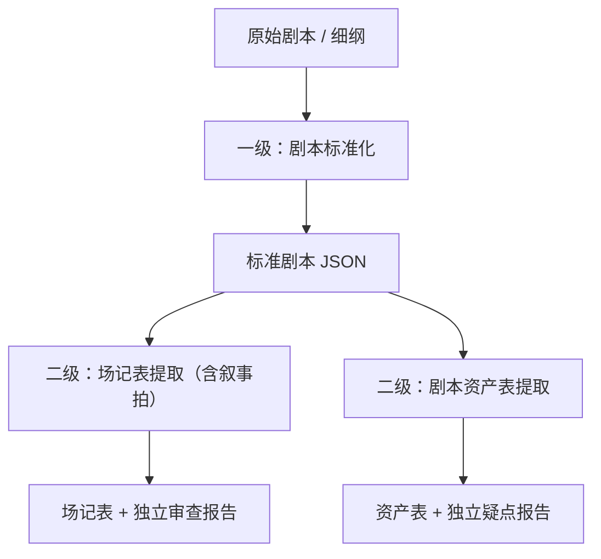

# 开宝箱工作室 · 剧本插件 1.0

> 公开测试镜像：剧本业务权威来源为 [script-plugins](https://github.com/kaibaoxiang-studio/script-plugins)，本目录固定其 `main` 提交 `c1a101d87cd2d35f8c92ac382ed34e3860fb046e`。统一测试仓库为 [script-assets-public-test](https://github.com/kaibaoxiang-studio/script-assets-public-test)，本轮固定标签为 `public-test-2026-10-27-r2`；安装与反馈入口见[统一测试说明](../README.md)。保留来源组件版本，以下历史测试数据不代表本轮重新执行了模型测试。

团队共建的三个业务插件：**剧本标准化（一级）**、**场记表提取（二级）**、**剧本资产表提取（二级）**。两项二级能力可读取同一份一级标准 JSON 并分别运行，资产表还提供标准 DOCX 主入口；节拍归入场记表。

项目版本为 **1.0.1（2026-10-22）**。剧本标准化组件为 **0.1.2**，其他三个组件仍为 **0.1.0**。仓库包含完整插件、维护源码、统一安装目录、独立 ZIP 和脱敏测试证据。

本镜像采用来源 `main` 的最新内容：剧本资产表提取插件外层版本仍为 **0.1.0**，其中标准 DOCX 主入口 `script-asset-extractor` 为 **0.1.1**。它与读取一级 JSON 的 `extract-asset-table` 兼容入口同时保留；向资产设计母插件交接时，优先使用保留来源哈希的标准剧本 JSON 与对应资产 JSON。

## 功能与交付

| 层级 | 插件 / 入口 | 输入 | 交付 |
| --- | --- | --- | --- |
| 一级 | [剧本标准化](level-1/screenplay-standardization/README.md) · standardize-screenplay / review-screenplay | DOCX、TXT、Markdown 剧本；纯细纲需经 Agent 创作 | 标准剧本 JSON / Markdown、独立疑点报告 |
| 二级 | [场记表提取](level-2/scene-log-extraction/README.md) · extract-scene-log | 完成的 standardized_screenplay_v1 JSON | 按叙事拍组织的 JSON、每集一页的 13 列 Excel、独立审查报告 |
| 二级 | [剧本资产表提取](level-2/asset-extraction/README.md) · script-asset-extractor / extract-asset-table | 标准剧本 DOCX 主入口；一级 JSON 兼容入口 | 人物 / 场景 / 道具 / 按需特效资产 JSON、Excel、独立疑点报告 |
| 额外工程 | [Harness Creator](engineering/README.md) · harness-creator | 业务需求、已有插件或知识 | 能力设计、源码、插件构建、维护与验证 |

**Harness Creator 是额外的通用工程，不属于一级或二级节点。** 三个业务插件均自带运行代码与知识，使用时无需另装 Creator。



框架只有一级和二级产物。资产提取以标准剧本原文为依据，不以场记表作为必需输入。

## 安装与使用

添加本轮统一公开测试市场：

```sh
codex plugin marketplace add https://github.com/kaibaoxiang-studio/script-assets-public-test.git --ref public-test-2026-10-27-r2
codex plugin add screenplay-standardizer@script-assets-public-test
codex plugin add scene-log-extractor@script-assets-public-test
codex plugin add screenplay-asset-extractor@script-assets-public-test
```

在统一公开市场分别安装三个剧本业务插件；该市场另提供资产设计总控，共四个业务插件。Creator 的工程资料保留用于源码维护，不列为本轮市场安装项。[安装说明](docs/installation.md)包含 CLI 命令、Python 运行时及调用示例。

1. 用「剧本标准化」得到 标准化剧本.json、标准化剧本.md 和独立疑点报告。
2. 将 **JSON** 交给场记表及资产表 JSON 兼容入口；资产表也可使用 `script-asset-extractor` 的标准 DOCX 主入口。Markdown 用于阅读。
3. 复核二级报告。摄影、灯光、表演、时长和制作需求须由制作方确认。

## 测试结果与范围

| 测试 | 已交付结果 | 边界 |
| --- | --- | --- |
| 一级真实业务样例 | 10 集、28 场、1 条疑点 | 经 Agent 整理和脚本校验，含定点修订 |
| 场记表第 1–2 集 | 5 场、28 拍、110 个原文单元、43 段对白；2 页各 13 列 | 交付前补记 3 处细节；最终 31 条提示：9 条上游来源提示、22 条制作不确定项 |
| 资产表全剧 | 28 场；22 人物、17 场景、26 道具、0 单列特效；3 条疑点 | 来源、结构和工作簿核对通过，仍需人工核定资产语义与遗漏 |
| 三份长稿资产验证 | 整稿结构验证；各前两集真实 Agent 提取 | 未逐集人工核定三部全剧 |
| 确定性检查 | Creator 24 通过；一级 10 通过 / 1 私有样稿跳过；场记 6 通过；资产验收脚本通过 | 与既有真实模型调用分开记录 |

细节、修正记录、匿名运行编号和产物哈希见[1.0 验证记录](docs/validation-v1.0.md)。真实剧本、完整业务产物和原始日志留在本地；本仓库保存统计证据和合成验收材料。

## 目录与维护

```text
level-1/screenplay-standardization/   一级：维护源码 + 独立插件
level-2/scene-log-extraction/         二级：原仓源码快照 + 独立插件
level-2/asset-extraction/             二级：维护源码 + 独立插件
engineering/harness-creator/         额外工程：通用插件建设与维护
.agents/plugins/marketplace.json     四个插件的统一安装目录
docs/validation/                     脱敏证据与版本基线
scripts/                            仓库检查与 ZIP 打包
```

creator-src 保存维护脚本、规则、蓝图和测试；同级插件目录是独立安装快照。场记源码来自团队 [ai-continuity-sheet](https://github.com/kaibaoxiang-studio/ai-continuity-sheet) 的固定版本，维护关系见其组件 README。

旧 capabilities/01–05 归档和三级设计保留在 Git 历史中。见 [CHANGELOG](CHANGELOG.md)、[开发说明](docs/development.md)、[贡献指南](CONTRIBUTING.md)和[来源说明](NOTICE.md)。
